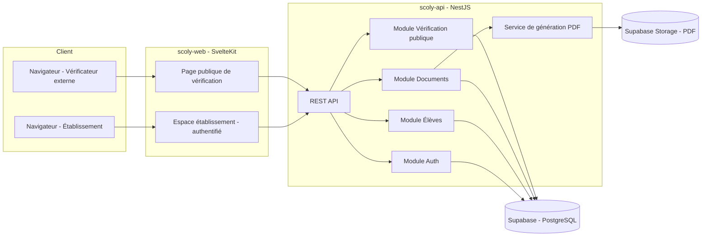
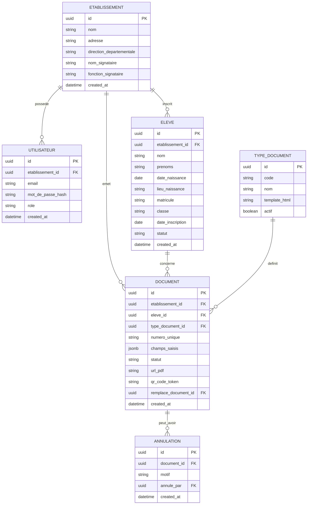

# ARCHITECTURE.md — Architecture technique de Scoly

Version 1.0. Ce document décrit les choix techniques et pourquoi ils sont
faits ainsi. À challenger si des contraintes (budget, compétences équipe,
hébergement imposé) l'exigent.

## 1. Principes directeurs

- **Simplicité avant tout** : le MVP a un périmètre fonctionnel restreint, la
  stack doit rester simple à opérer par une petite équipe (voire un seul
  développeur).
- **Léger côté client** : contexte de connexion parfois lente → éviter les
  frameworks lourds mal optimisés, limiter le JS envoyé au navigateur.
- **PDF = livrable central** : la fiabilité et la qualité du rendu PDF priment
  sur tout le reste techniquement.
- **Multi-tenant dès le départ** : toutes les tables métier sont rattachées à
  un `etablissement_id`, avec la sécurité au niveau applicatif ET base de
  données.
- **Auditabilité** : rien n'est supprimé, tout est tracé (documents, statuts,
  annulations).

## 2. Stack technique retenue

| Couche | Choix | Justification |
|---|---|---|
| Frontend | **SvelteKit + TypeScript + TailwindCSS** | Framework léger, peu de JS envoyé au navigateur (important vu les connexions parfois lentes), SSR natif utile pour la page publique de vérification, très bonne DX |
| Backend | **Node.js + NestJS + TypeScript** | Structure claire (modules/services/controllers), bon écosystème pour REST/Auth, indépendant du choix de frontend |
| Base de données | **PostgreSQL managé par Supabase** | Hébergement géré (sauvegardes automatiques, interface d'administration incluse), sans changer le modèle relationnel prévu |
| ORM | **Prisma** (connecté directement à la base Postgres de Supabase) | Migrations simples, typé, bonne DX avec TypeScript/NestJS ; le backend NestJS garde la main sur l'accès aux données |
| Génération PDF | **Puppeteer (Chromium headless) rendant un template HTML/CSS** | Permet de designer les modèles de documents en HTML/CSS (facile à ajuster visuellement), fidèle à l'impression A4 |
| QR Code | **librairie `qrcode` (Node)** | Génération simple d'un QR code encodant l'URL de vérification |
| Stockage des fichiers PDF | **Supabase Storage** | Mutualisé avec la base de données (un seul fournisseur à gérer), buckets privés avec accès via URLs signées générées par le backend |
| Authentification | **JWT custom (access + refresh token), géré par NestJS** | Supabase sert uniquement de base de données ; l'authentification reste entièrement sous contrôle du backend (pas de dépendance à Supabase Auth) |
| Hébergement (proposition) | **Backend sur un VPS ou Railway/Render ; Base de données et stockage sur Supabase ; Frontend (SvelteKit) sur Vercel/Netlify ou le même VPS** | Coût maîtrisé au MVP, scalable ensuite si besoin |

### Précisions sur l'usage de Supabase

Supabase propose aussi sa propre solution d'authentification (Supabase Auth)
et un système de sécurité au niveau des lignes (Row Level Security). **On
n'utilise ni l'un ni l'autre** dans cette architecture :

- **Authentification** : gérée entièrement par NestJS (JWT custom), comme
  prévu initialement. Le backend se connecte à la base Supabase via la
  chaîne de connexion Postgres standard (Prisma), sans passer par le SDK
  Supabase Auth.
- **Isolation multi-tenant** : assurée au niveau applicatif (guards NestJS
  vérifiant l'`etablissement_id`), pas via des policies RLS Supabase. C'est
  cohérent avec le fait que seul le backend NestJS parle directement à la
  base — aucun client (frontend) n'interroge Supabase directement.
- **Stockage** : le backend NestJS communique avec **Supabase Storage** via
  son SDK/API pour uploader les PDF générés et générer des URLs signées à
  durée limitée (téléchargement/réimpression depuis l'espace établissement).
  Les buckets restent **privés** — un PDF n'est jamais exposé publiquement
  par son URL brute ; seule la page de vérification (qui n'affiche pas le
  PDF lui-même, seulement les métadonnées autorisées) est publique.

### Deux projets séparés, reliés par API

Contrairement à une approche monorepo, **le frontend et le backend sont deux
projets/dépôts distincts** :

- `scoly-api` (NestJS) : expose uniquement une API REST (JSON), ne sert aucune
  page HTML
- `scoly-web` (SvelteKit) : consomme l'API via HTTP, ne connaît aucun détail
  d'implémentation du backend (base de données, ORM, etc.)

Ce découpage a deux conséquences à assumer :

- **Pas de partage automatique de types TypeScript** entre front et back
  (contrairement à un monorepo). Deux options possibles, à trancher ensemble
  quand l'équipe sera en place :
  - dupliquer les types/interfaces des réponses API dans le frontend (simple,
    mais à resynchroniser manuellement en cas de changement d'API)
  - publier un petit package npm partagé (`@scoly/api-types`) généré depuis
    le backend, importé par le frontend
- **Le contrat d'API doit être explicite et stable** : on documentera les
  endpoints (routes, payloads, réponses) au fur et à mesure dans
  `ARCHITECTURE.md` ou un fichier OpenAPI dédié, pour que les deux projets
  puissent avancer sans dépendre du code interne l'un de l'autre.

Ce découpage facilite aussi le déploiement indépendant des deux projets et
l'arrivée éventuelle d'autres clients de l'API en V2 (application mobile,
intégrations tierces).

## 3. Schéma d'architecture globale



## 4. Modèle de données



### Notes de modélisation

- `Document.champs_saisis` (JSONB) stocke les champs variables propres au
  type de document (ex. assiduité, conduite, observations pour le certificat
  de scolarité). Ceci évite de créer une table par type de document et
  facilite l'ajout de nouveaux types en V1 sans migration lourde.
- `Document.numero_unique` : format lisible et non devinable, ex.
  `SCO-2026-XXXXXX` (préfixe établissement ou année + suffixe aléatoire).
- `Document.qr_code_token` : identifiant opaque (UUID ou token signé), utilisé
  dans l'URL publique de vérification — volontairement distinct du
  `numero_unique` affiché, pour ne pas exposer de structure devinable.
- `Document.statut` : `actif` | `annule`.
- `Document.remplace_document_id` : lien optionnel vers l'ancien document
  remplacé (traçabilité interne, non affiché publiquement).
- `Eleve.statut` : permet de gérer les élèves partis/transférés sans les
  supprimer (utile pour l'historique de leurs documents).

## 5. Génération de PDF — approche détaillée

1. Chaque `TypeDocument` a un **template HTML/CSS** versionné (stocké en base
   ou en fichier selon simplicité de déploiement), avec des variables
   (`{{eleve.nom}}`, `{{document.champs_saisis.assiduite}}`, etc.)
2. À la génération : le backend injecte les données dans le template (moteur
   type Handlebars ou simple interpolation de chaîne), obtient un HTML final
3. Puppeteer charge ce HTML et exporte un PDF au format A4 avec marges fixes
4. Le QR code est généré côté serveur (image PNG en base64) et injecté
   directement dans le HTML avant l'export PDF
5. Le PDF final est uploadé vers **Supabase Storage** (bucket privé) ; l'URL
   ou la référence de l'objet est stockée dans `Document.url_pdf`. Le
   téléchargement depuis l'espace établissement se fait via une URL signée
   générée à la demande par le backend (durée de validité limitée)
6. Le PDF n'est **jamais régénéré après coup** : une fois créé, le fichier est
   figé et conservé tel quel, même si le template évolue plus tard (garantit
   qu'un document déjà émis reste identique à ce qui a été imprimé)

## 6. Vérification publique (QR code)

- Le QR code encode une URL du type :
  `https://scoly.app/verifier/{qr_code_token}`
- Cette route est **publique, sans authentification**, en lecture seule
- Le backend expose un endpoint dédié qui ne retourne que les champs
  autorisés à l'affichage public (voir `SPEC.md` §4.5) — jamais l'objet
  `Document` complet
- Trois cas de réponse :
  - **Valide** : bandeau vert, infos minimales (élève, type, établissement,
    numéro, date)
  - **Annulé** : bandeau orange/rouge, mention claire de non-validité, date
    d'annulation
  - **Introuvable** : token inconnu → message d'erreur neutre (ne pas
    confirmer/infirmer l'existence d'un vrai token pour limiter l'énumération)

## 7. Authentification & sécurité

- JWT access token (courte durée, ex. 15 min) + refresh token (plus long,
  stocké en cookie httpOnly)
- Mots de passe hashés avec `bcrypt`/`argon2`
- Toutes les requêtes authentifiées passent par un guard NestJS qui vérifie
  l'appartenance des ressources (`eleve_id`, `document_id`) à
  l'`etablissement_id` de l'utilisateur connecté — **jamais de confiance dans
  un ID transmis par le client sans vérification du tenant**
- Rate limiting sur les routes sensibles (connexion, endpoint de vérification
  publique) pour limiter les abus/bruteforce
- Sauvegardes automatiques quotidiennes de la base de données (les documents
  administratifs sont critiques, aucune perte tolérée) — Supabase propose des
  sauvegardes automatiques selon le plan choisi ; à vérifier que le plan
  retenu couvre une fréquence et une rétention suffisantes, sinon prévoir un
  export automatisé complémentaire

## 8. Organisation du code (deux dépôts séparés)

```
scoly-api/                 # Dépôt 1 — Backend NestJS
├── src/
│   ├── auth/
│   ├── etablissements/
│   ├── eleves/
│   ├── documents/
│   ├── verification/      # Endpoint public de vérification QR
│   └── pdf/                # Service de génération PDF (Puppeteer)
├── prisma/
│   ├── schema.prisma
│   └── migrations/
├── docs/                   # OpenAPI / contrat d'API partagé avec le front
└── docker-compose.yml      # Optionnel : outils locaux (ex. Supabase CLI)

scoly-web/                  # Dépôt 2 — Frontend SvelteKit
├── src/
│   ├── routes/
│   │   ├── (app)/          # Espace établissement authentifié
│   │   │   ├── tableau-de-bord/
│   │   │   ├── eleves/
│   │   │   ├── documents/
│   │   │   ├── archives/
│   │   │   └── parametres/
│   │   └── verifier/[token]/  # Page publique de vérification
│   ├── lib/
│   │   ├── api/            # Client HTTP vers scoly-api
│   │   └── types/           # Types des réponses API (dupliqués ou générés)
│   └── app.html
└── package.json

scoly-docs/ (ou dossier séparé)
├── SPEC.md
├── ARCHITECTURE.md
└── PLAN.md
```

Les documents produit/techniques (`SPEC.md`, `ARCHITECTURE.md`, `PLAN.md`)
peuvent vivre dans l'un des deux dépôts (ex. `scoly-api/docs/`) ou dans un
dépôt dédié — à trancher selon préférence, cela n'a pas d'impact technique.

## 9. Environnements

| Environnement | Usage |
|---|---|
| **Local (dev)** | Un projet Supabase dédié au développement (base + storage), ou environnement local via la Supabase CLI (`supabase start`, qui simule Postgres + Storage en Docker) |
| **Staging** | Environnement de recette avant mise en prod, données de test |
| **Production** | Données réelles des établissements |

## 10. Points ouverts à trancher ensemble

- Nom de domaine et hébergement définitifs
- Politique de sauvegarde/rétention exacte (durée de conservation légale des
  documents administratifs scolaires au Bénin ?)
- Mode de facturation des établissements (hors périmètre technique immédiat,
  mais impacte le modèle `Etablissement` — statut d'abonnement, etc.)
